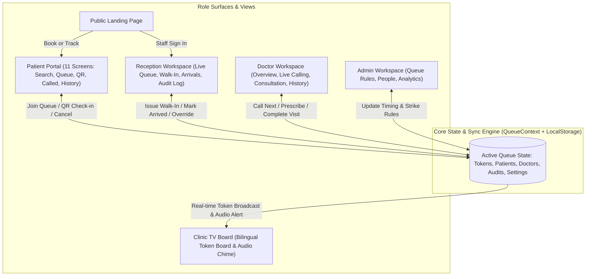
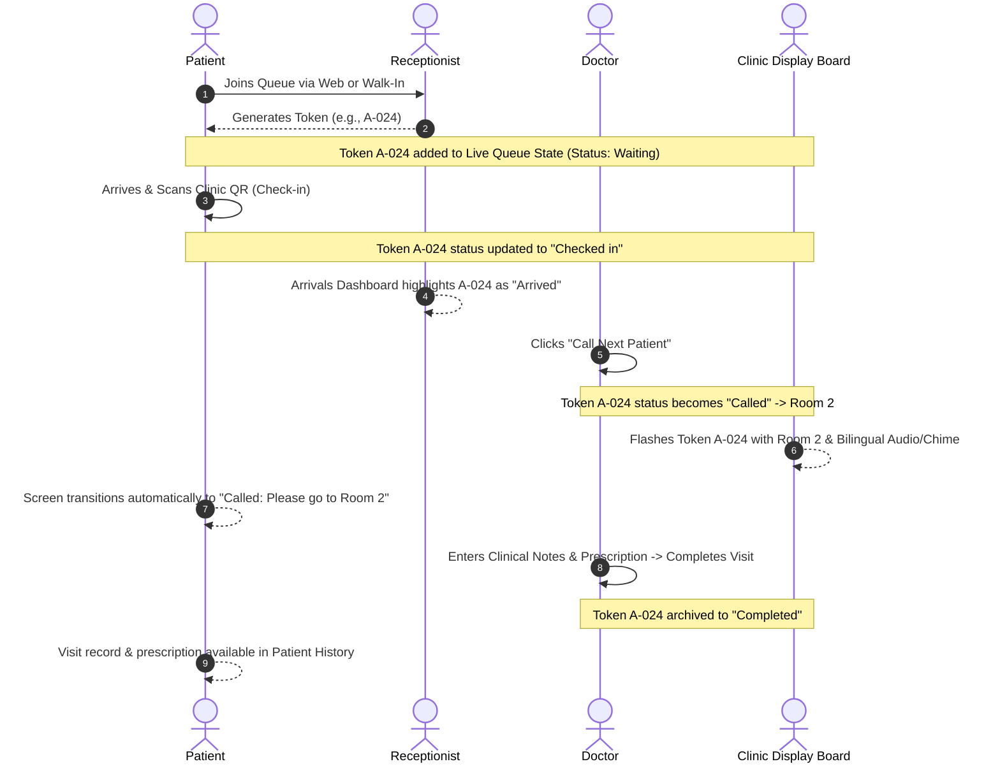

# QTrack Frontend: Full Architecture & Execution Blueprint

> [!NOTE]
> This blueprint decomposes the monolithic template into a modular, production-grade frontend architecture. It defines the synchronized reactive state model, UX workflows, component hierarchy, and an actionable step-by-step checklist.

---

## 1. System Architecture & Reactive Data Flow

Although the backend and database will be integrated later by teammates, the frontend will implement a **Unified Reactive State Engine** backed by `localStorage`. This ensures that when an action happens anywhere (e.g. Doctor calls a token, Reception issues a walk-in, Patient checks in via QR), **every view immediately reacts in real-time**.



---

## 2. Global State & Interaction Model



---

## 3. Project Directory Reorganization

We will transition from the single monolithic [App.tsx](file:///c:/Users/AONAK%20YADAV/Downloads/qtrack-updated-source/qtrack-updated/src/App.tsx) into a clean, modular folder structure:

```
src/
├── types/
│   ├── queue.ts            # QueueItem, Patient, Doctor, Status, Priority
│   ├── consultation.ts     # Prescriptions, ClinicalNotes, MedicalHistory
│   ├── settings.ts         # CheckInWindow, StrikeLimit, DemotionRules
│   └── audit.ts            # AuditLogEntry, ActionTypes
├── context/
│   ├── QueueContext.tsx    # Unified reactive state engine & localStorage sync
│   └── AudioContext.tsx    # Audio cues & speech synthesizer for TV announcements
├── data/
│   ├── initialData.ts      # Realistic seed data for doctors, patients, queues
│   └── clinicConstants.ts  # Department rules, specialties, fees
├── components/
│   ├── common/             # Button, Badge, Card, Field, Select, Modal, Toast
│   ├── layout/             # AppHeader, Sidebar, PatientBottomNav, PrototypeBar
│   ├── landing/            # Hero, Features, Steps, ClinicSection, Footer
│   ├── patient/            # PatientHome, DoctorSearch, DoctorProfile, QueueTracker,
│   │                       # QRScannerModal, CalledAlert, HistoryView, ProfileView
│   ├── receptionist/       # LiveQueueTable, WalkInModal, ArrivalsList, ActivityLog
│   ├── doctor/             # DoctorOverview, CallingQueue, ConsultationRoom, CompletedTable
│   ├── admin/              # ClinicSettings, StaffManager, AnalyticsCharts
│   └── display/            # TVTokenBoard, FlashServingCard, NextTokensBar
├── App.tsx                 # Clean role router & top-level layout coordinator
└── index.css               # Existing design system preserved and extended
```
