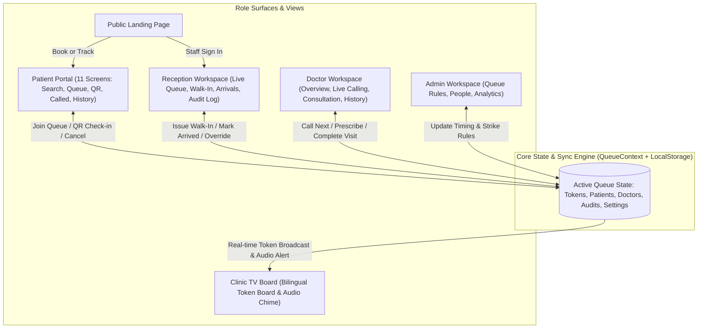
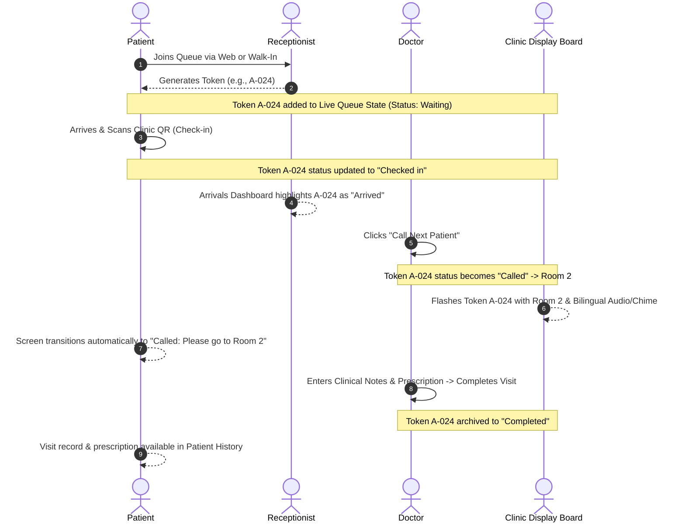

# QTrack Frontend: Full Architecture & Execution Blueprint

> [!NOTE]
> This blueprint decomposes the monolithic template into a modular, production-grade frontend architecture. It defines the synchronized reactive state model, UX workflows, component hierarchy, and an actionable step-by-step checklist.

---

## 1. System Architecture & Reactive Data Flow

Although the backend and database will be integrated later by teammates, the frontend will implement a **Unified Reactive State Engine** backed by `localStorage`. This ensures that when an action happens anywhere (e.g. Doctor calls a token, Reception issues a walk-in, Patient checks in via QR), **every view immediately reacts in real-time**.



---

## 2. Global State & Interaction Model



---

## 3. Project Directory Reorganization

We will transition from the single monolithic [App.tsx](file:///c:/Users/AONAK%20YADAV/Downloads/qtrack-updated-source/qtrack-updated/src/App.tsx) into a clean, modular folder structure:

```
src/
├── types/
│   ├── queue.ts            # QueueItem, Patient, Doctor, Status, Priority
│   ├── consultation.ts     # Prescriptions, ClinicalNotes, MedicalHistory
│   ├── settings.ts         # CheckInWindow, StrikeLimit, DemotionRules
│   └── audit.ts            # AuditLogEntry, ActionTypes
├── context/
│   ├── QueueContext.tsx    # Unified reactive state engine & localStorage sync
│   └── AudioContext.tsx    # Audio cues & speech synthesizer for TV announcements
├── data/
│   ├── initialData.ts      # Realistic seed data for doctors, patients, queues
│   └── clinicConstants.ts  # Department rules, specialties, fees
├── components/
│   ├── common/             # Button, Badge, Card, Field, Select, Modal, Toast
│   ├── layout/             # AppHeader, Sidebar, PatientBottomNav, PrototypeBar
│   ├── landing/            # Hero, Features, Steps, ClinicSection, Footer
│   ├── patient/            # PatientHome, DoctorSearch, DoctorProfile, QueueTracker,
│   │                       # QRScannerModal, CalledAlert, HistoryView, ProfileView
│   ├── receptionist/       # LiveQueueTable, WalkInModal, ArrivalsList, ActivityLog
│   ├── doctor/             # DoctorOverview, CallingQueue, ConsultationRoom, CompletedTable
│   ├── admin/              # ClinicSettings, StaffManager, AnalyticsCharts
│   └── display/            # TVTokenBoard, FlashServingCard, NextTokensBar
├── App.tsx                 # Clean role router & top-level layout coordinator
└── index.css               # Existing design system preserved and extended
```

---

## 4. Phase-by-Phase Execution Checklist

Each phase contains specific, verifiable deliverables that can be completed, tested in the browser, and checked off sequentially.

### Phase 1: Foundation & Reactive Data Architecture
- [ ] **Step 1.1**: Define TypeScript interfaces in `src/types/` (`QueueItem`, `Patient`, `Doctor`, `Consultation`, `ClinicSettings`, `AuditRecord`).
- [ ] **Step 1.2**: Create realistic mock dataset in `src/data/initialData.ts` representing active clinic queues, verified doctors, and medical histories.
- [ ] **Step 1.3**: Implement `QueueContext` with reactive state handlers:
  - `joinQueue(details)`
  - `callNext(doctorId, tokenId)`
  - `checkInToken(tokenId)`
  - `markArrived(tokenId)`
  - `saveConsultation(visitRecord)`
  - `addWalkIn(walkInData)`
  - `logActivity(action, reason)`
  - `updateSettings(newSettings)`
- [ ] **Step 1.4**: Extract and standardize UI atoms in `src/components/common/` (`Button`, `Card`, `Badge`, `Field`, `SelectField`, `Modal`, `ToastNotification`).

### Phase 2: Public Landing Page Polish & Flow Transitions
- [ ] **Step 2.1**: Break landing page into modular sections (`LandingNav`, `LandingHero`, `FeaturesGrid`, `HowItWorksSteps`, `ForClinicsBlock`, `LandingFooter`).
- [ ] **Step 2.2**: Connect "Book an appointment" to direct doctor search & queue joining.
- [ ] **Step 2.3**: Connect "Track my queue" directly to the patient's active token dashboard.
- [ ] **Step 2.4**: Connect "Staff sign in" directly to the Receptionist/Doctor login portals.

### Phase 3: Patient Experience (11 Sub-Views)
- [ ] **Step 3.1: Home Dashboard**: Live token card showing real-time position ahead and dynamic estimated wait time.
- [ ] **Step 3.2: Doctor Discovery & Search**: Interactive filtering by specialty, availability, fee, and language with live search queries.
- [ ] **Step 3.3: Doctor Profile**: Full profile details, timings, consultation fees, and live queue length preview.
- [ ] **Step 3.4: Join Queue Flow**: Multi-step modal (Myself vs Family Member, symptoms/reason, cost summary) with instant token issuance.
- [ ] **Step 3.5: My Queue (Live Monitor)**: Real-time countdown timer for check-in window, late pass mechanism (`"I'm running late"`), strike tracker (1-3 strikes).
- [ ] **Step 3.6: Interactive QR Check-in**: Live camera simulation or click-to-scan that actually updates queue status to `"Checked in"` across all clinic screens.
- [ ] **Step 3.7: Called Screen**: Triggered automatically when doctor calls the patient's token, with room guidance (`"Room 2"`).
- [ ] **Step 3.8: Medical History & Prescriptions**: View past visits, dynamic prescription modal, and downloadable PDF visit summary preview.
- [ ] **Step 3.9: Profile & Family Management**: Add/edit family members, manage allergy tags and chronic conditions.
- [ ] **Step 3.10: Phone & OTP Authentication**: Interactive verification code inputs with countdown resend timer.

### Phase 4: Receptionist Workspace
- [ ] **Step 4.1: Live Queue Manager**: Tabbed view by Doctor (Dr. Sharma, Dr. Nair, All), priority markers, search/filter by token or patient name.
- [ ] **Step 4.2: 10-Second Quick Walk-In**: Functional modal that instantly creates a new token (`A-025`), prints/previews ticket with QR code, and adds it to the queue.
- [ ] **Step 4.3: Real-Time Arrivals Board**: Filter patients whose arrival window is open, one-click `"Mark arrived"`.
- [ ] **Step 4.4: Transparent Activity & Override Log**: Live timeline logging every priority flag, duplicate token removal, or manual queue reordering.
- [ ] **Step 4.5: Staff Authentication**: Secure login gate for receptionist credentials.

### Phase 5: Doctor Workspace
- [ ] **Step 5.1: Clinical Daily Overview**: Real-time stats (Waiting, Seen Today, Avg Consultation Time), Up-Next patient preview, Queue health metrics.
- [ ] **Step 5.2: Live Calling Station**: "Call next patient" button that moves checked-in patients to `"Called"`, syncs with the Display Board, and notifies patient.
- [ ] **Step 5.3: Consultation Room Workspace**:
  - Prominent allergy alerts (e.g. Penicillin) and chronic illness banners.
  - Interactive prescription builder (medicine name, dosage, frequency, duration, add/remove row).
  - Diagnosis and clinical notes editor.
  - "Save and complete visit" action that automatically archives the consultation and calls the next patient.
- [ ] **Step 5.4: Completed Visits Archive**: Searchable log of finished consultations with timestamps and diagnoses.

### Phase 6: Clinic Display Board & Admin Control
- [ ] **Step 6.1: Dual-Language TV Display**: Fullscreen TV-optimized UI with English & Hindi token callouts (`NOW SERVING · अभी आपकी बारी`).
- [ ] **Step 6.2: Audio Chime & Speech Alert**: Optional sound chime when a new token is called to room number.
- [ ] **Step 6.3: Next-Up Queue Ticker**: Real-time rotating upcoming tokens.
- [ ] **Step 6.4: Admin Clinic Settings**: Dynamic settings form controlling check-in window (minutes), demotion skips, and maximum strike count.
- [ ] **Step 6.5: Staff & Role Manager**: Add/remove clinic staff, doctor duty schedules.
- [ ] **Step 6.6: Analytics Dashboard**: Dynamic chart showing hourly patient peak flow, no-show rates, and wait time averages.

### Phase 7: Verification, Responsiveness & Polish
- [ ] **Step 7.1**: Test complete end-to-end user loop across tabs or windows (Patient books -> Receptionist checks in -> Doctor calls -> Display announces -> Doctor completes -> Patient history updates).
- [ ] **Step 7.2**: Verify mobile responsiveness (bottom navigation bar on mobile, full desktop layouts for staff).
- [ ] **Step 7.3**: Run `tsc --noEmit` and `npm run build` to confirm zero lint or type errors.
